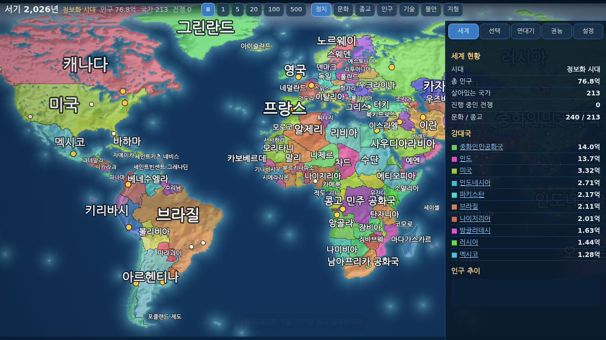
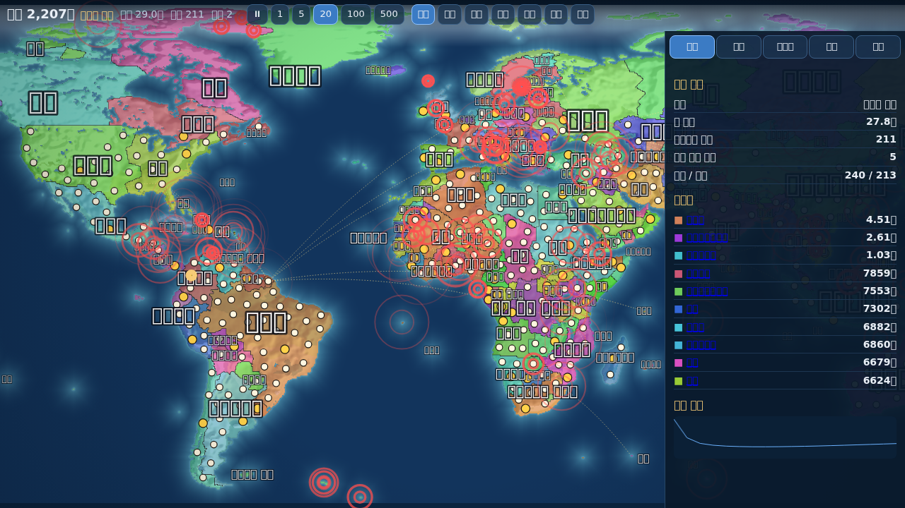
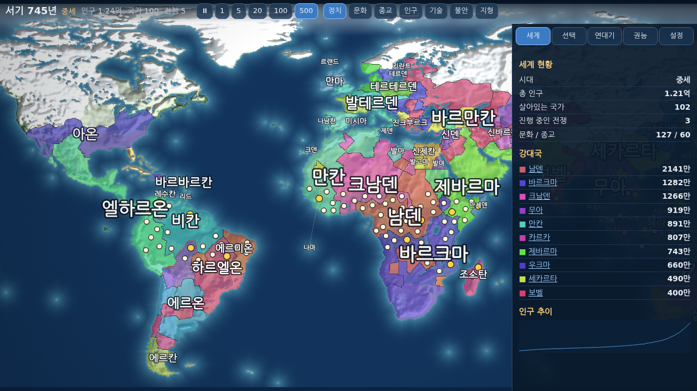
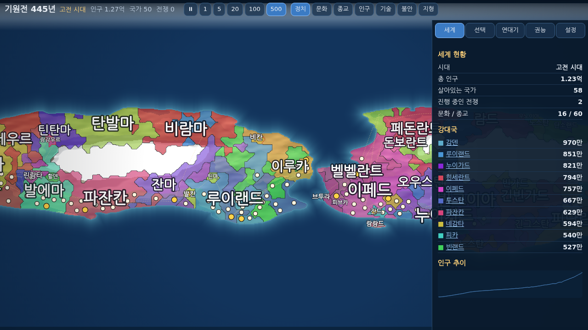
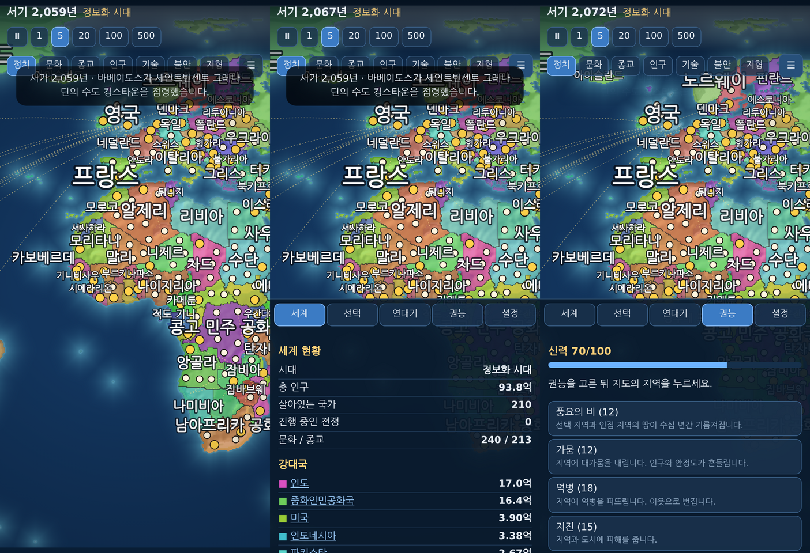

# 태초의 지도 (Genesis Atlas)

지도 위에서 문명이 태어나고, 자라고, 무너지는 모습을 끝없이 지켜보는 신(神) 시뮬레이터입니다. 설치 없이 브라우저에서 바로 실행됩니다.

**플레이: https://sigco3111.github.io/genesis-atlas/**

쌍둥이 대륙 지도에서 태초부터 시작한 모습:

모바일 화면: 지역을 누르면 하단 패널에 상세 정보가 열립니다.

## 무엇을 할 수 있나

- **지도 선택**: 현실 지구(기본), 초대륙, 쌍둥이 대륙, 군도, 내해 세계, 조각난 대륙, 무작위 세계.
- **시작 방식 선택** (지도와 별개, 기본은 시대별 세계·2026년):
  - 시대별 세계: 14개 시점(기원전 10000·3000·500·323년, 서기 100·600·1000·1279·1492·1650·1815·1914·1945·2026년) 중 하나를 골라, 당시 국가·세력 배치와 기술 수준으로 시작합니다 (지구 지도 전용).
  - 태초부터: 기원전 10000년, 씨앗 부족 몇 곳에서 문명이 자라납니다.
- **시뮬레이션**: 인구 성장, 기술 시대(석기~우주), 국가 건국과 붕괴, 전쟁과 점령, 반란과 분열, 역병, 재해, 종교와 문화 분화, 교역로, 정체(政體) 변화, 연대기 기록.
- **개입은 선택**: 아무것도 안 해도 계속 흘러갑니다. 원하면 12가지 권능(풍요의 비, 가뭄, 역병, 지진, 화산, 운석, 새 부족, 예언자, 영웅, 봉기, 평화의 신탁, 전쟁의 불씨)을 횟수 제한 없이 마음껏 쓸 수 있고, `자동 신 위임`을 켜면 균형을 알아서 맞춥니다.
- **지도 모드**: 정치, 문화, 종교, 인구, 기술, 불안, 지형.
- **속도**: 일시정지, 0.5, 1, 3, 10, 100년/초. 기본 1년/초(이전 5년/초)로 늦춰 나라가 바뀌는 모습을 뜯어볼 수 있게 했고, 현재 속도가 연도 옆에 항상 표시됩니다.
- **저장**: 20초마다 브라우저에 자동 저장, 파일 내보내기/불러오기. 저장 데이터가 깨져 있으면 부팅 점검에서 폐기하고 새로 시작합니다.
- 데스크톱(드래그/휠)과 모바일(드래그/핀치/하단 패널) 조작을 지원합니다.
- **전쟁 시각화**: 진행 중인 전쟁의 교전 지역이 지도 위 붉은 X 표시(추적 국가의 전쟁은 금색)로 맥박처럼 표시됩니다. 최근 3년간 점령된 지방에는 점령국 색의 진격 화살표와 회전하는 점선 링이 남아 누가 어디로 밀고 들어오는지 바로 보입니다. 추적 카드의 전쟁 줄이나 위쪽 `전쟁 N` 표시를 누르면 해당 전선으로 이동합니다.
- **권능 미리보기와 결과 요약**: 권능을 고르면 마우스가 닿은 지역(모바일은 한 번 눌러 고른 지역)에 영향 범위가 색으로 미리 표시됩니다 - 초록은 도움, 빨강은 피해, 회색은 쓸 수 없는 대상. 발동 전 예상 효과(인구 감소 폭, 안정도 변화, 전쟁 종전 수 등)를 보여 주고, 발동 후에는 인구·도시·안정도·영토의 실제 변화와 연대기 사건을 결과 카드로 요약합니다. 모바일에서는 한 번 눌러 미리보기를 확인한 뒤 `여기에 발동`을 눌러 확정하므로 오터치를 막습니다.
- **국가별 연대기**: 연대기 탭 위쪽의 국가 칩(추적·선택 국가)을 누르거나 선택 탭의 `연대기 전체 보기`를 누르면, 그 나라의 건국부터 지도자 교체·전쟁 선포와 종전·도시 점령·동맹·봉기·멸망·신의 권능 개입까지 한 흐름으로 모아 봅니다. 사건을 누르면 일어난 위치로 지도가 이동합니다(📍 표시, 모바일은 패널이 접히며 지도가 보입니다). 전쟁 선포나 점령처럼 상대국이 있는 사건은 양쪽 나라의 연대기에 모두 기록됩니다.
- **국가 비교**: `비교` 탭에서 두 나라를 고르면 인구(세계 점유율)·영토·안정도·기술·군사력 추정·전적(승률)·건국·지도자를 나란히 보여 주고 우세한 쪽을 초록으로 표시합니다. 두 나라의 인구 추이를 같은 눈금의 이중 선 그래프(10년 간격 기록)로 겹쳐 보여 주고 기록 시작 이후 증감률도 비교합니다. 서로 전쟁 중이면 전쟁 배너가, 외교 관계가 있으면 관계 점수가 뜨고, 각 나라 위치로 바로 이동할 수 있습니다. 선택 탭의 `⇄ 이 국가 비교하기`나 비교 탭의 칩(선택 지역·추적 국가 담기)으로 나라를 담습니다.
- **국가 추적**: 선택 탭의 `☆ 이 국가 추적`이나 세계 탭 강대국 목록의 ☆로 관심 국가를 고정하면, 화면 왼쪽 위 카드에 인구·지방(영토) 증감, 안정도, 진행 중인 전쟁, 최근 소식(누르면 현장으로 이동)과 인구 추이 그래프가 계속 뜨고, `연대기` 버튼으로 그 나라의 전체 기록을 열 수 있습니다. 추적 중인 국가는 지도에서 금색 경계선과 ★ 라벨로 표시됩니다. 멸망하면 카드에 기록이 남습니다. 카드 상단 국가명을 누르면 한 줄로 접혀 지도를 덜 가리고, 다시 누르면 펼쳐집니다.
- **패널 접기/펼치기**: 정보 패널이 지도를 가릴 때 패널 위쪽의 `패널 접기` 버튼이나 파란색 가장자리 손잡이(`패널 접기`/`패널 펼치기`, 모바일은 ☰ 버튼도 가능)로 접어 지도 전체를 볼 수 있습니다. 지역을 누르면 패널이 다시 열립니다.

## 한계 (솔직하게)

- 시대별 세계는 '당시 세계를 근사한 시작 시나리오'입니다. 경계·국명은 historical-basemaps 커뮤니티 자료 기준이라 오류(거친 해안선, 누락된 작은 섬, 남아 있을 수 있는 시대 불일치 국명)가 섞여 있습니다. 자료에 없는 땅은 '미확인(무주)'으로 비워 두며 임의로 메우지 않습니다. 원본 자료가 이름을 비워 둔 넓은 내륙(시대에 따라 아프리카 내륙, 아라비아 내부, 파타고니아, 마다가스카르 등)도 무주로 두며, 그 땅의 인구는 시작 인구에서 제외됩니다(시대에 따라 세계 인구의 수 %).
- 확인된 시대 부정확 국명은 근거를 갖고 고쳤습니다: 1000년 '덴마크-노르웨이' → '덴마크 왕국'(당시 복합 국가 '덴마크-노르웨이'는 존재하지 않음). 1492년과 1650년의 '덴마크-노르웨이'는 1380-1814년 동군연합 실체에 부합하므로 유지합니다. 1492년 '메티스(Métis)'는 모피무역 이후에 형성된 정체성이라 15세기에는 존재하지 않아, 이 지역이 접촉 이전부터 아니시나베·크리 등이 사용한 지역이라는 기록을 근거로 '아니시나베족'으로 바꿨습니다. 다만 이 폴리곤의 정확한 15세기 거주 집단을 확정할 자료는 없는 근사 표기입니다. 또한 원본이 이름 칸만 비우고 소속 메타데이터를 둔 지역은 그 표기로 복원했습니다: 1815년 네덜란드 본토('United Kingdom of Netherlands')와 네덜란드령 동인도 섬들, 1279년 도싯 문화(북극 제도), 1650년 러시아 소유 섬.
- 눈에 띄는 국가·세력 이름과 각 시대 상위 국가는 한국어로 표기합니다. 나머지 소수 세력(전체 항목의 약 2할)은 한국어 번역이 없어 영어로 표시됩니다.

- 지구 국경은 Natural Earth 50m 데이터의 근사입니다. 현대 국경과 다를 수 있고, 시뮬레이션이 진행되면 대체 역사로 갈라집니다.
- 실제 모바일 기기에서의 조작감과 성능은 아직 실측하지 않았습니다 (헤드리스 Chrome으로만 확인).
- 장기 균형(수만 년 단위)은 몇 개의 시드로만 시험했습니다. 국가 수가 시간이 지나며 늘어나는 경향이 남아 있습니다.
- 일부 도시 이름은 한국어 번역이 없어 영어로 표시됩니다.

## 검증한 것

- `node test/smoke.mjs`: 7개 지도와 지구의 두 시작 방식을 돌려 예외, NaN, 저장·복원 오류를 검사합니다.
- `node test/cmp.mjs`: 국가별 인구·영토 추이 기록(비교 차트용)이 10년 간격으로 쌓이고, 멸망 시 0으로 마감되며, 저장·복원과 구형 저장 호환을 검사합니다.
- `node test/natlog.mjs`: 국가별 연대기가 전쟁·동맹·점령 사건의 상대국까지 함께 기록하고, 저장·복원 후에도 유지되는지 검사합니다.
- 헤드리스 Chrome(소프트웨어 렌더링)에서 500년/초로 약 2만 년을 3분 넘게 돌려 보았습니다. 오류 없이 진행되었고 메모리와 저장 크기(약 1MB)는 늘지 않았습니다.
- 같은 환경에서 폰 크기 화면은 대부분 60fps였고, 데스크톱 크기의 '현재의 세계' 모드는 속도에 따라 20~43fps였습니다. 실제 기기는 측정하지 않았습니다.
- 지구 8개 시드의 기술 시대 도달 시점과 지배 국가 비중을 확인했습니다 (한 나라가 세계를 독점하는 경우 없음).

## 개발

빌드 과정 없는 순수 ES 모듈입니다. 로컬 실행: `python3 -m http.server` 후 `http://localhost:8000`.
헤드리스 시험: `node test/run.mjs <earth|real|archipelago...> <년수> <시드>`.

## 출처와 크레딧

- 지도 데이터: [Natural Earth](https://www.naturalearthdata.com/) (퍼블릭 도메인) - 국가 경계, 호수, 음영기복.
- 디자인 영감: hegemony-war, WorldBox, Fantasy Map Simulator. 코드나 에셋은 가져오지 않았습니다.

## 자료 출처와 라이선스

- 현대 지구 경계: Natural Earth 50m (public domain).
- 시대별 경계·세력: [aourednik/historical-basemaps](https://github.com/aourednik/historical-basemaps) (GPL-3.0). 이 저장소의 `data/era/*.json`은 이 자료에서 파생된 결과물로, GPL-3.0 조건(라이선스 사본 `LICENSE-data-gpl3.txt` 동봉, 저작권·변경 고지, 대응하는 소스 제공)으로 배포됩니다. 재생성에 필요한 전체 파이프라인(경계 스냅샷 내려받기·래스터화·라벨 교정·HYDE 추출 스크립트와 주 단위 인구 배열 `tools/hyde/pops/`)이 이 저장소 `tools/`에 함께 있습니다. GPL-3.0이 부여하는 권리(상업적 이용 포함)는 이 파생물에 그대로 적용됩니다. 별개로 원저작자가 상업적 이용을 원하지 않는다는 뜻을 밝힌 기록(저장소 이슈 #76)이 있어 참고로 남깁니다; 이는 법적 조건이 아니며 GPL의 권리를 제한하지 않습니다.
- 시대별 인구: HYDE 3.2 (Klein Goldewijk et al., Utrecht University) - 라이선스 [CC BY 4.0](https://creativecommons.org/licenses/by/4.0/) (데이터세트 동봉 readme와 DOI 10.24416/UU01-XUTQN5 랜딩 페이지 모두 CC BY 4.0 명기, 2026-10-23 확인). CC BY 4.0의 조건(저작자 표시, 라이선스 고지, 변경 사항 표시)에 따라: 인용은 Klein Goldewijk, Beusen, Doelman, Stehfest (2017), Earth Syst. Sci. Data 9:927-953 (doi.org/10.5194/essd-9-927-2017)이며, 변경 내용은 다음과 같습니다 - 원본 5분각 격자 인구를 게임의 주(州) 단위로 합산했고, 자료가 없는 연도(-500, -323, 1279, 1492, 1650, 1815, 1945)는 가장 가까운 두 연도의 선형 보간값이며, 해안가 격자 약 1% 내외는 게임 지도 해상도 차이로 제외됩니다. 원저작자가 이 게임을 후원하거나 보증한다는 뜻이 아닙니다.
