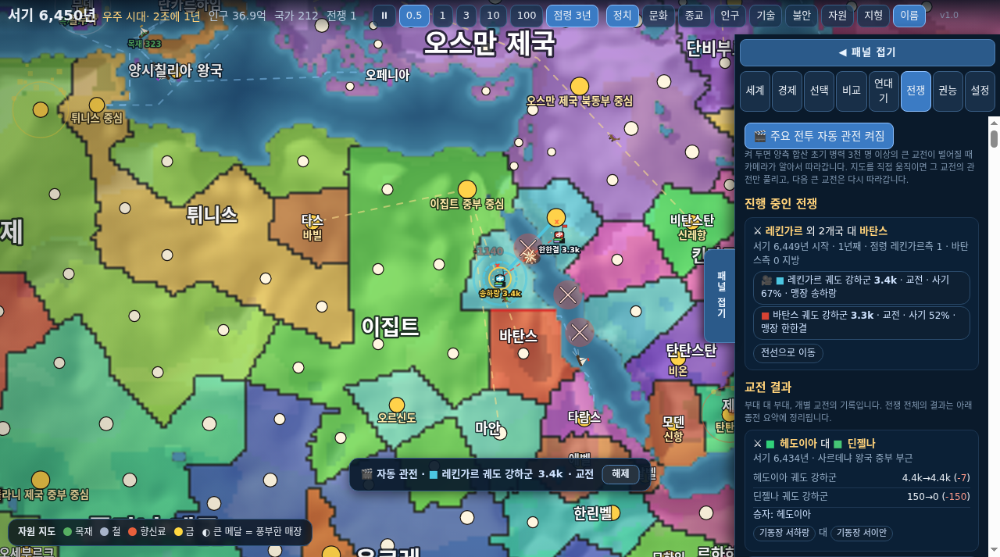

# 시대의 물결 (Genesis Atlas)

지도 위에서 문명이 태어나고, 자라고, 무너지는 모습을 끝없이 지켜보는 신(神) 시뮬레이터입니다. 설치 없이 브라우저에서 바로 실행됩니다.

**플레이: https://sigco3111.github.io/genesis-atlas/** · 현재 버전 **v1.0** (2026-10-24 완료본)

새 배포가 반영됐는지는 화면에서 버전으로 확인할 수 있습니다(시작 화면 부제와 게임 상단 바 오른쪽 끝). 배포 직후에도 버전이 그대로면 브라우저가 이전 화면 파일을 잠시 보관 중인 것이니, 몇 분 기다리거나 완전 새로고침해 주세요.

쌍둥이 대륙 지도에서 태초부터 시작한 모습:

모바일 화면: 지역을 누르면 하단 패널에 상세 정보가 열립니다.

## 무엇을 할 수 있나

- **지도 선택**: 현실 지구(기본), 초대륙, 쌍둥이 대륙, 군도, 내해 세계, 조각난 대륙, 무작위 세계.
- **시작 방식 선택** (지도와 별개, 기본은 시대별 세계·2026년):
  - 시대별 세계: 14개 시점(기원전 10000·3000·500·323년, 서기 100·600·1000·1279·1492·1650·1815·1914·1945·2026년) 중 하나를 골라, 당시 국가·세력 배치와 기술 수준으로 시작합니다 (지구 지도 전용).
  - 태초부터: 기원전 10000년, 씨앗 부족 몇 곳에서 문명이 자라납니다.
- **시뮬레이션**: 인구 성장, 기술 시대(석기~우주), 국가 건국과 붕괴, 전쟁과 점령, 반란과 분열, 역병, 재해, 종교와 문화 분화, 교역로, 정체(政體) 변화, 연대기 기록.
- **항해**: 국가 사이에 바닷길이 열리면 항로를 따라 무역선이 왕복하고(입항 때 지식이 오감), 항해 기술을 갖춘 연안 국가는 탐험선을 보내 바다 건너 새 땅에 해외 정착지를 세웁니다. 항로는 지형의 수역 마스크 위에서 경로탐색으로 찾은 물길만 따라가며, 물길이 검증되지 않는 항로는 열리지 않습니다. 탐험선의 항로와 목적지가 지도에 표시되고, 폭풍에 실종되기도 합니다.
- **개입은 선택**: 아무것도 안 해도 계속 흘러갑니다. 원하면 12가지 권능(풍요의 비, 가뭄, 역병, 지진, 화산, 운석, 새 부족, 예언자, 영웅, 봉기, 평화의 신탁, 전쟁의 불씨)을 횟수 제한 없이 마음껏 쓸 수 있고, `자동 신 위임`을 켜면 균형을 알아서 맞춥니다.
- **지도 모드**: 정치, 문화, 종교, 인구, 기술, 불안, 지형.
- **속도**: 일시정지, 0.5, 1, 3, 10, 100년/초. 기본 1년/초(이전 5년/초)로 늦춰 나라가 바뀌는 모습을 뜯어볼 수 있게 했고, 현재 속도가 연도 옆에 항상 표시됩니다.
- **저장**: 20초마다 브라우저에 자동 저장, 파일 내보내기/불러오기. 저장 데이터가 깨져 있으면 부팅 점검에서 폐기하고 새로 시작합니다.
- 데스크톱(드래그/휠)과 모바일(드래그/핀치/하단 패널) 조작을 지원합니다.
- **전쟁 시각화**: 진행 중인 전쟁의 교전 지역이 지도 위 붉은 X 표시(추적 국가의 전쟁은 금색)로 맥박처럼 표시됩니다. 최근에 점령된 지방에는 점령국 색의 진격 화살표와 회전하는 점선 링이 남아 누가 어디로 밀고 들어오는지 바로 보입니다. 상단 `점령` 버튼으로 이 표시가 남는 시간을 바꿀 수 있습니다(누를 때마다 3년 → 10년 → 30년 → 끄기, 기본 3년). 추적 카드의 전쟁 줄이나 위쪽 `전쟁 N` 표시를 누르면 해당 전선으로 이동합니다.
- **자율 부대 전투**: 전쟁이 나면 나라가 스스로 부대를 편성합니다. 국기 색 깃발 칩과 병력 숫자로 보이는 부대가 지도 위를 실제로 행군하고, 적 부대를 만나면 회전을 벌이며, 도시는 포위 끝에 점령합니다. 진 쪽은 후퇴하거나 전멸하고, 전쟁이 끝나면 부대는 해산해 고향으로 돌아갑니다. 빠른 진행(1초에 20년 이상)에서는 표시를 생략합니다. `전쟁` 탭의 부대 목록에서 부대를 누르면 카메라가 그 부대를 계속 따라갑니다(🎥). 행군·교전·후퇴하는 모습을 놓치지 않고 볼 수 있고, 지도를 직접 드래그·확대하거나 `해제` 버튼·Esc로 추적을 풀 수 있습니다. 부대가 해산하면 추적도 자동으로 끝납니다.
- **시대별 병종**: 부대는 국가의 기술 시대에 따라 다른 표식을 답니다. 돌도끼 전사·청동 창병·철기 검병·군단 중보병·중세 기병·화승총병·소총·포병·기갑 부대·정밀 타격군·궤도 강하군으로 아이콘이 바뀌고, 시대가 높을수록 전투력이 강해지며 기병·기갑 같은 병종은 행군 속도도 빠릅니다. 전투 기록에도 병종이 함께 남습니다.
- **권능 미리보기와 결과 요약**: 권능을 고르면 마우스가 닿은 지역(모바일은 한 번 눌러 고른 지역)에 영향 범위가 색으로 미리 표시됩니다 - 초록은 도움, 빨강은 피해, 회색은 쓸 수 없는 대상. 발동 전 예상 효과(인구 감소 폭, 안정도 변화, 전쟁 종전 수 등)를 보여 주고, 발동 후에는 인구·도시·안정도·영토의 실제 변화와 연대기 사건을 결과 카드로 요약합니다. 모바일에서는 한 번 눌러 미리보기를 확인한 뒤 `여기에 발동`을 눌러 확정하므로 오터치를 막습니다. 미리보기와 결과 카드는 `접기`로 한 줄로 줄여 지도를 가리지 않게 할 수 있고, 접힌 상태에서도 발동·취소·권능 해제는 그대로 쓸 수 있습니다(결과 카드는 `✕`로 바로 닫기).
- **국가별 연대기**: 연대기 탭 위쪽의 국가 칩(추적·선택 국가)을 누르거나 선택 탭의 `연대기 전체 보기`를 누르면, 그 나라의 건국부터 지도자 교체·전쟁 선포와 종전·도시 점령·동맹·봉기·멸망·신의 권능 개입까지 한 흐름으로 모아 봅니다. 사건을 누르면 일어난 위치로 지도가 이동합니다(📍 표시, 모바일은 패널이 접히며 지도가 보입니다). 전쟁 선포나 점령처럼 상대국이 있는 사건은 양쪽 나라의 연대기에 모두 기록됩니다.
- **교전 결과 카드**: `전쟁` 탭에서 부대 대 부대의 개별 교전이 끝날 때마다(후퇴·전멸·흩어짐) 양측의 초기→남은 병력과 손실, 승자, 패주군의 후퇴 방향, 양측 지휘관을 한 장의 카드로 남깁니다. 카드를 누르면 교전이 벌어진 위치로 이동합니다(📍). 양측 합산 손실 150 미만의 가벼운 접촉은 남기지 않고, 최근 40장을 보관하며 저장·이어하기에도 유지됩니다. 전쟁 전체의 결과는 기존처럼 종전 요약에 정리됩니다.
- **지휘관 전적**: `전쟁` 탭에서 부대를 이끈 지휘관마다 참전 수·승패·승률과 주요 전투(합산 손실이 큰 교전 3개)를 모아 보여 줍니다. 교전 카드의 지휘관 이름이나 목록의 이름을 누르면 상세 카드가 열리고, 주요 전투는 눌러서 그 위치로 이동할 수 있습니다(📍). 전멸한 부대의 지휘관은 전사(⚰)로, 지금 부대를 이끄는 지휘관은 현역으로 표시됩니다. 교전 카드(최근 40장 순환)와 달리 전적은 누적되어 저장·이어하기에도 유지되며, 최대 100명분을 보관합니다(현역 우선).
- **주요 전투 자동 관전**: `전쟁` 탭의 `🎬 주요 전투 자동 관전`을 켜 두면(기본 꺼짐) 양측 합산 초기 병력 3천 명 이상의 큰 교전이 벌어질 때 카메라가 알아서 그 전장을 따라갑니다(🎬 칩 표시). 가장 큰 교전 하나를 병력이 많은 쪽 부대에 붙어 보여 주고, 교전이 끝나면(후퇴·전멸·흩어짐) 카메라를 놓아줍니다. 지도를 직접 드래그·확대하거나 `해제` 버튼·Esc를 누르면 그 교전의 관전만 풀리고 다음 큰 교전은 다시 따라갑니다. 부대 목록에서 직접 고른 수동 추적(🎥)이 자동 관전보다 우선하며, 부대를 직접 명령하는 기능 없이 관전만 합니다. 다만 1년 안에 승부가 나는 짧은 교전은 시뮬레이션 틱 사이에 끝나 관전이 잡지 못하고, 빠른 진행에서는 관전이 잡혀도 순식간에 지나가므로, 사실상 몇 해에 걸쳐 싸우는 큰 교전을 느린 속도로 보는 용도입니다.

- **전쟁 결과 요약**: `전쟁` 탭에서 진행 중인 전쟁(기간·지금까지의 점령 수·전선으로 이동)과 끝난 전쟁의 결과를 봅니다. 종전 카드에는 개전~종전 연도와 기간, 승자(또는 휴전), 측별 점령 지방 수, 양국의 영토(지방 수)와 인구의 개전→종전 변화가 정리되고, 수도·대도시 같은 주요 점령은 눌러서 그 위치로 이동할 수 있습니다. 인구·영토 변화는 전쟁 기간 중 전체 증감이며 전쟁으로 인한 손실만을 뜻하지 않습니다. 한쪽이 멸망해 끝난 전쟁도 승자와 함께 기록됩니다. 최근 60건을 보관하며 저장·이어하기에도 유지됩니다.
- **국가 비교**: `비교` 탭에서 두 나라를 고르면 인구(세계 점유율)·영토·안정도·기술·군사력(세계 대비)·전적(승률)·건국·지도자를 나란히 보여 주고 우세한 쪽을 초록으로 표시합니다. 성장 추이는 인구·영토·안정도 세 지표를 칩으로 골라 같은 눈금의 이중 선 그래프(10년 간격 기록, 안정도는 0~100% 고정 눈금)로 겹쳐 보여 주고, `같은 기간의 증감` 표로 두 나라가 기록을 모두 가진 구간의 인구 증감률·영토 증감 지방 수·안정도 %p 변화를 나란히 비교합니다. 서로 전쟁 중이면 전쟁 배너가, 외교 관계가 있으면 관계 점수가 뜨고, 각 나라 위치로 바로 이동할 수 있습니다. 선택 탭의 `⇄ 이 국가 비교하기`나 비교 탭의 칩(선택 지역·추적 국가 담기)으로 나라를 담습니다.
- **국가 추적**: 선택 탭의 `☆ 이 국가 추적`이나 세계 탭 강대국 목록의 ☆로 관심 국가를 고정하면, 화면 왼쪽 위 카드에 인구·지방(영토) 증감, 안정도, 진행 중인 전쟁, 최근 소식(누르면 현장으로 이동)과 인구 추이 그래프가 계속 뜨고, `연대기` 버튼으로 그 나라의 전체 기록을 열 수 있습니다. 추적 중인 국가는 지도에서 금색 경계선과 ★ 라벨로 표시됩니다. 멸망하면 카드에 기록이 남습니다. 카드 상단의 `접기` 버튼(또는 국가명 줄)을 누르면 한 줄로 접혀 지도를 덜 가리고, `펼치기`로 다시 엽니다. 카드의 `⚔ 전쟁 시작·종료 시 자동 정지`를 켜 두면 추적 국가가 전쟁을 시작하거나 전쟁이 끝날 때(멸망 포함) 자동으로 일시정지해 중요한 전황을 놓치지 않습니다. 기본은 꺼짐이며, 스페이스바로 바로 재개할 수 있습니다.
- **지도 라벨 자동 정리**: 국가명과 도시명은 확대 정도에 따라 표시 개수가 자동으로 조절되고, 겹치는 이름은 큰 나라·수도부터 남깁니다. 전체 지도를 보고 있을 때는 주요 국가만 표시되어 모바일에서도 빽빽하게 겹치지 않습니다. 수도 이름은 금색빛으로 조금 더 일찍(낮은 확대에서도) 나타납니다. 상단 `이름` 버튼으로 모든 이름을 끄고 켤 수 있습니다. 추적 중인 국가는 ★ 금색 라벨로 빛나 어느 줌에서도 항상 표시되고, 그 나라의 전선 표시도 더 크게 강조됩니다. 부대가 몰린 전장에서는 부대 칩 주변의 국가·도시 이름을 자동으로 숨기고, 병력 숫자는 칩이나 다른 숫자·도시 이름과 겹치지 않는 자리에 큰 부대부터 배치합니다(아주 붐비면 큰 부대 5개까지만). 사상자 숫자도 붐빌수록 큰 것 위주로 줄어듭니다. 추적 중인 부대(🎥)는 금색 링과 금색 병력 숫자로 어느 전장에서도 바로 눈에 띕니다.
- **패널 접기/펼치기**: 정보 패널이 지도를 가릴 때 패널 위쪽의 `패널 접기` 버튼이나 파란색 가장자리 손잡이(`패널 접기`/`패널 펼치기`, 모바일은 ☰ 버튼도 가능)로 접어 지도 전체를 볼 수 있습니다. 지역을 누르면 패널이 다시 열립니다.
- **지역 자원과 교역 경제**: 지방마다 목재·철·향신료·금 매장량이 있고(`자원` 지도 모드), 국가는 생산·수요·비축·국고를 가집니다. 항구 도시국가의 무역선이 남는 물자를 실제 화물로 싣고 바닷길을 건너 모자란 나라의 항구에 내려 대금을 주고받습니다. 곡물은 인구 성장과 기근, 목재·철은 기술 진보와 군사력, 향신료·금은 기술·안정도·국고에 반영됩니다. `경제` 탭과 선택 탭에서 자급률·교역 덕분에 오른 폭을 볼 수 있습니다. 자원을 둘러싼 전쟁은 아직 없습니다.
- **육상 대상 교역**: 이웃 국가 사이와, 항구가 없는 내륙 국가를 포함해 서로 모자란 물자가 맞물리는 국가 사이에 육로가 열립니다. 육로는 지형의 지상 마스크 위에서 경로탐색으로 찾은 길만 따라가며(바다를 가로지르는 직선은 없습니다), 짐짐이 대상이 길을 따라 걸어 왕복합니다. 대상은 무역선보다 적게 싣고 느리지만, 도착하면 같은 방식으로 화물을 내리고 대금을 주고받으며 지식도 오갑니다. `경제` 탭에서 무역선과 대상의 운송을 나누어 볼 수 있습니다.

## 한계 (솔직하게)

- 시대별 세계는 '당시 세계를 근사한 시작 시나리오'입니다. 경계·국명은 historical-basemaps 커뮤니티 자료 기준이라 오류(거친 해안선, 누락된 작은 섬, 남아 있을 수 있는 시대 불일치 국명)가 섞여 있습니다. 자료에 없는 땅은 '미확인(무주)'으로 비워 두며 임의로 메우지 않습니다. 원본 자료가 이름을 비워 둔 넓은 내륙(시대에 따라 아프리카 내륙, 아라비아 내부, 파타고니아, 마다가스카르 등)도 무주로 두며, 그 땅의 인구는 시작 인구에서 제외됩니다(시대에 따라 세계 인구의 수 %).
- 확인된 시대 부정확 국명은 근거를 갖고 고쳤습니다: 1000년 '덴마크-노르웨이' → '덴마크 왕국'(당시 복합 국가 '덴마크-노르웨이'는 존재하지 않음). 1492년과 1650년의 '덴마크-노르웨이'는 1380-1814년 동군연합 실체에 부합하므로 유지합니다. 1492년 '메티스(Métis)'는 모피무역 이후에 형성된 정체성이라 15세기에는 존재하지 않아, 이 지역이 접촉 이전부터 아니시나베·크리 등이 사용한 지역이라는 기록을 근거로 '아니시나베족'으로 바꿨습니다. 다만 이 폴리곤의 정확한 15세기 거주 집단을 확정할 자료는 없는 근사 표기입니다. 또한 원본이 이름 칸만 비우고 소속 메타데이터를 둔 지역은 그 표기로 복원했습니다: 1815년 네덜란드 본토('United Kingdom of Netherlands')와 네덜란드령 동인도 섬들, 1279년 도싯 문화(북극 제도), 1650년 러시아 소유 섬.
- 눈에 띄는 국가·세력 이름과 각 시대 상위 국가는 한국어로 표기합니다. 나머지 소수 세력(전체 항목의 약 2할)은 한국어 번역이 없어 영어로 표시됩니다.

- 지구 국경은 Natural Earth 50m 데이터의 근사입니다. 현대 국경과 다를 수 있고, 시뮬레이션이 진행되면 대체 역사로 갈라집니다.
- 실제 모바일 기기에서의 조작감과 성능은 아직 실측하지 않았습니다 (헤드리스 Chrome으로만 확인).
- 장기 균형(수만 년 단위)은 몇 개의 시드로만 시험했습니다. 국가 수가 시간이 지나며 늘어나는 경향이 남아 있습니다.
- 일부 도시 이름은 한국어 번역이 없어 영어로 표시됩니다.

## 검증한 것

- `node test/labels.mjs`: 줌 단계별 국가·도시 라벨 개수 제한, 겹침 회피, 추적 국가의 우선 배치와 밀집 전장의 부대 라벨 배치(칩 상자 회피, 예산, 추적 부대 강제 배치)를 검사합니다.
- `node test/battles.mjs`: 개별 교전의 개시·손실 집계·후퇴/전멸/이탈 마감, 카드 상한, 구형 저장 호환, 실제 전쟁 시뮬레이션에서의 카드 생성과 저장·복원 유지, 지휘관 전적(참전·승패·주요 전투·전사 기록, 번호 없는 옛 저장 지휘관 기록)을 검사합니다.
- `node test/spectate.mjs`: 주요 전투 자동 관전의 대상 선택(병력 기준·가장 큰 교전·놓아준 교전 제외·행군/후퇴/전멸 부대 제외·초기 병력 기준 유지)과 진행 중 판정(마감·전멸·후퇴·상태 복귀 시 종료)을 검사합니다.
- `node test/warhist.mjs`: 개전 스냅샷, 측별 점령 집계, 종전 요약(승패·기간·멸망국 처리), 구형 저장 호환, 실제 시뮬레이션 결합을 검사합니다.
- `node test/follow.mjs`: 부대 추적 카메라의 추적 위치 선택(렌더 위치 우선, 고속 진행·첫 프레임은 시뮬 위치)과 카메라 완화(정지·단조 접근·수렴)를 검사합니다.
- `node test/warwatch.mjs`: 점령 표시 유지 시간 단계·필터·투명도와 추적 국가의 전쟁 발발·종전 감지를 검사합니다. 실제 시뮬레이션에서 전쟁을 일으켜 발발·종전 감지와 저장·복원 호환도 확인합니다.
- `node test/smoke.mjs`: 7개 지도와 지구의 두 시작 방식을 돌려 예외, NaN, 저장·복원 오류를 검사합니다.
- `node test/ships.mjs`: 해상 항로 전 구간 수역, 육로 전 구간 육지, 무역선·대상 배정과 왕복, 탐험선 정착, 저장·복원을 검사합니다.
- `node test/econ.mjs`: 자원 분포, 화물 보존(적재=하역+운송 중+유실, 무역선·대상 합산), 대금 정산, 기존 저장 이어하기, 교역의 자급률·인구 효과를 검사합니다.
- `node test/cmp.mjs`: 국가별 인구·영토·안정도 추이 기록(비교 차트용)이 10년 간격으로 쌓이고, 멸망 시 0으로 마감되며, 저장·복원과 구형 저장 호환을 검사합니다.
- `node test/cmptrend.mjs`: 비교 추이 계산(같은 기간 창, 지표별 증감·표기, 구형 3요소 기록 호환)을 검사합니다.
- `node test/natlog.mjs`: 국가별 연대기가 전쟁·동맹·점령 사건의 상대국까지 함께 기록하고, 저장·복원 후에도 유지되는지 검사합니다.
- 헤드리스 Chrome(소프트웨어 렌더링)에서 500년/초로 약 2만 년을 3분 넘게 돌려 보았습니다. 오류 없이 진행되었고 메모리와 저장 크기(약 1MB)는 늘지 않았습니다.
- 같은 환경에서 폰 크기 화면은 대부분 60fps였고, 데스크톱 크기의 '현재의 세계' 모드는 속도에 따라 20~43fps였습니다. 실제 기기는 측정하지 않았습니다.
- 지구 8개 시드의 기술 시대 도달 시점과 지배 국가 비중을 확인했습니다 (한 나라가 세계를 독점하는 경우 없음).
- v1.0 완료 전 통합 점검(2026-10-24, 실제 배포 환경): 새 게임(시대별 세계 2026·태초부터)과 저장 이어하기 부팅, 수천 년 장기 진행, 수동 부대 추적(카메라 추종·드래그 해제)과 자동 관전(큰 교전 포착·추종·교전 종료 시 자동 해제), 교전 카드·지휘관 전적·종전 요약 표시, 390×844 모바일 에뮬레이션 레이아웃을 데스크톱 Chromium에서 확인했습니다. 콘솔 오류는 없었습니다. 실제 iPhone 등 실기기 확인은 포함하지 않습니다.

## 개발

빌드 과정 없는 순수 ES 모듈입니다. 배포할 때는 index.html과 js 모듈 참조의 `?v=` 쿼리를 함께 올려야 Pages의 파일 캐시를 우회합니다(화면 파일 자체는 수분 캐시됩니다). 로컬 실행: `python3 -m http.server` 후 `http://localhost:8000`.
헤드리스 시험: `node test/run.mjs <earth|real|archipelago...> <년수> <시드>`.

## 출처와 크레딧

- 지도 데이터: [Natural Earth](https://www.naturalearthdata.com/) (퍼블릭 도메인) - 국가 경계, 호수, 음영기복.
- 디자인 영감: hegemony-war, WorldBox, Fantasy Map Simulator. 코드나 에셋은 가져오지 않았습니다.

## 자료 출처와 라이선스

- 현대 지구 경계: Natural Earth 50m (public domain).
- 시대별 경계·세력: [aourednik/historical-basemaps](https://github.com/aourednik/historical-basemaps) (GPL-3.0). 이 저장소의 `data/era/*.json`은 이 자료에서 파생된 결과물로, GPL-3.0 조건(라이선스 사본 `LICENSE-data-gpl3.txt` 동봉, 저작권·변경 고지, 대응하는 소스 제공)으로 배포됩니다. 재생성에 필요한 전체 파이프라인(경계 스냅샷 내려받기·래스터화·라벨 교정·HYDE 추출 스크립트와 주 단위 인구 배열 `tools/hyde/pops/`)이 이 저장소 `tools/`에 함께 있습니다. GPL-3.0이 부여하는 권리(상업적 이용 포함)는 이 파생물에 그대로 적용됩니다. 별개로 원저작자가 상업적 이용을 원하지 않는다는 뜻을 밝힌 기록(저장소 이슈 #76)이 있어 참고로 남깁니다; 이는 법적 조건이 아니며 GPL의 권리를 제한하지 않습니다.
- 시대별 인구: HYDE 3.2 (Klein Goldewijk et al., Utrecht University) - 라이선스 [CC BY 4.0](https://creativecommons.org/licenses/by/4.0/) (데이터세트 동봉 readme와 DOI 10.24416/UU01-XUTQN5 랜딩 페이지 모두 CC BY 4.0 명기, 2026-10-23 확인). CC BY 4.0의 조건(저작자 표시, 라이선스 고지, 변경 사항 표시)에 따라: 인용은 Klein Goldewijk, Beusen, Doelman, Stehfest (2017), Earth Syst. Sci. Data 9:927-953 (doi.org/10.5194/essd-9-927-2017)이며, 변경 내용은 다음과 같습니다 - 원본 5분각 격자 인구를 게임의 주(州) 단위로 합산했고, 자료가 없는 연도(-500, -323, 1279, 1492, 1650, 1815, 1945)는 가장 가까운 두 연도의 선형 보간값이며, 해안가 격자 약 1% 내외는 게임 지도 해상도 차이로 제외됩니다. 원저작자가 이 게임을 후원하거나 보증한다는 뜻이 아닙니다.
